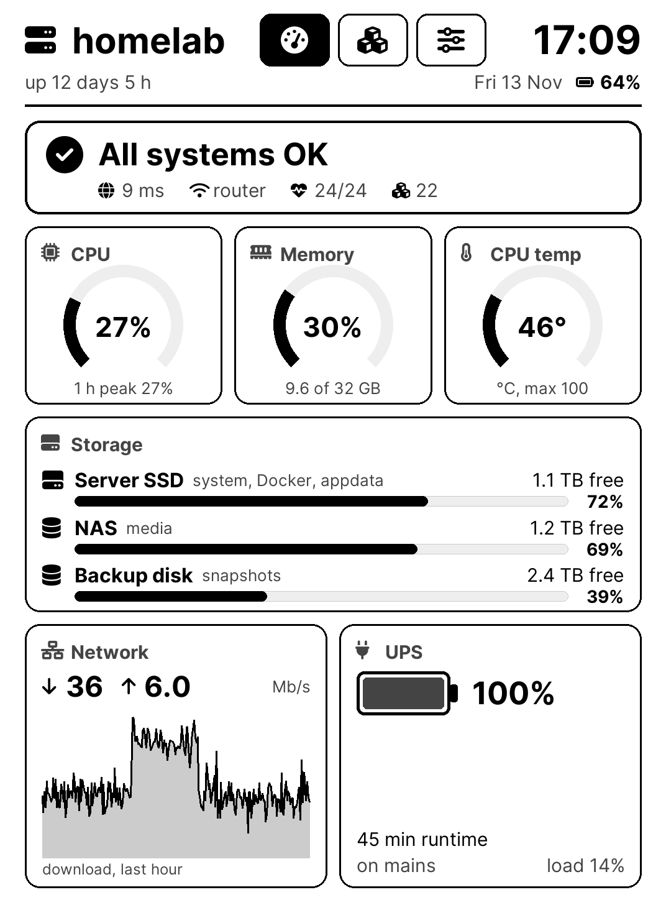
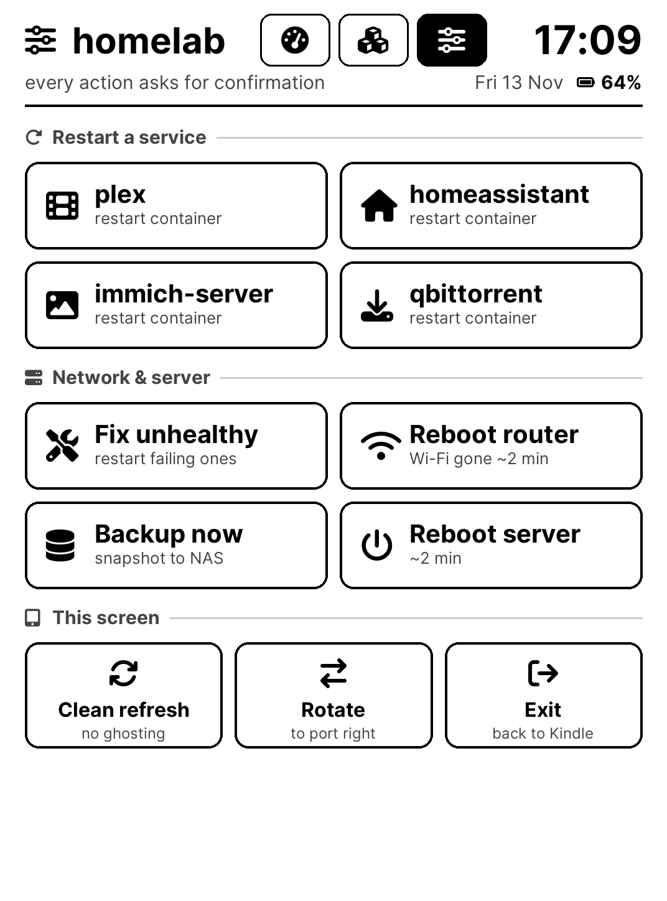
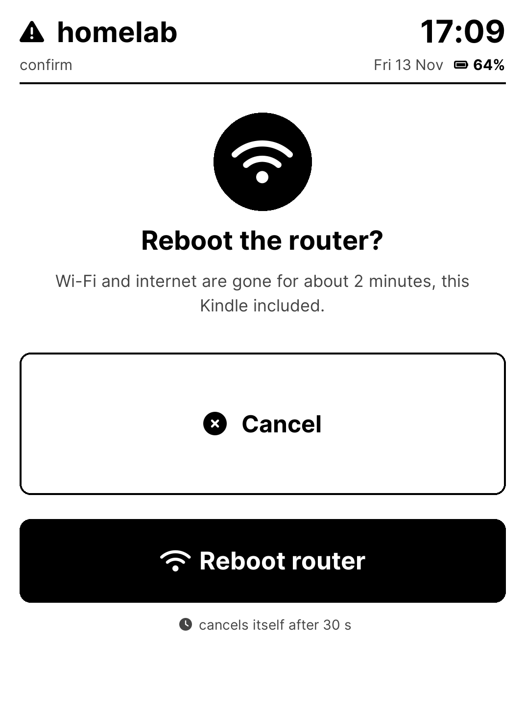
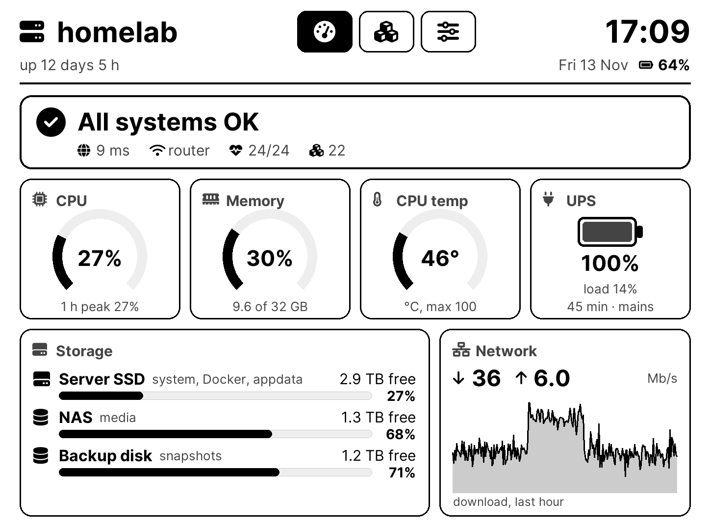

# Kindle homelab dashboard

Turn a jailbroken Kindle into a wall-mounted touch screen for your home server: health at a glance,
and the few buttons you want when something is off (restart a container, reboot the router, reboot the
server). E-ink, so it is readable in a dark cabinet or a hallway and sips power.

| Status | Actions | Confirm | Landscape |
| --- | --- | --- | --- |
|  |  |  |  |

*Screenshots use made-up demo data.*

- **Status**: one-line verdict ("All systems OK" or the list of problems), CPU / memory / CPU temperature
  gauges, disk usage (local disks and NAS mounts, and it notices hung network mounts), network traffic
  with a one-hour graph, UPS (via NUT), Gatus checks, simple HTTP checks.
- **Containers**: every Docker container with its state; tap one to restart (or start) it.
- **Actions**: up to 4 container shortcuts and up to 4 configurable actions (built-ins, a command in a
  container, or an HTTP call). Every action asks for a confirming tap.
- Portrait or landscape (either side up), switchable from the screen. Goes back to Status after 2 minutes.
- The Kindle's own battery is in the header; an unplugged Kindle running low is listed as a problem.
- A 3D-printable **wall frame** for it, hanging in portrait or landscape:
  [Kindle Paperwhite smart home dashboard frame](https://makerworld.com/en/models/3609308-kindle-paperwhite-smart-home-dashboard-frame)
  on MakerWorld.

## How it works

```
 Kindle (jailbroken)                         Server (Docker)
 ┌──────────────────────┐   GET /k/screen    ┌───────────────────────────────┐
 │ loop.sh              │ ─────────────────▶ │ app.py                        │
 │  • shows the PNG     │   ?x=&y= on a tap  │  • collects data (Docker API, │
 │    with eips         │ ◀───────────────── │    /proc, NUT, Gatus, HTTP)   │
 │  • reads the touch   │   PNG, or 204 if   │  • draws the page (Pillow)    │
 │    screen, sends     │   nothing changed  │  • maps taps to buttons and   │
 │    raw taps          │                    │    runs the actions           │
 └──────────────────────┘                    └───────────────────────────────┘
```

The Kindle is a thin client: a small shell script that pauses the Kindle UI, shows whatever PNG the
server sends and reports where you tapped. All layout, state and actions live in one Python file on the
server, so changing the dashboard never means touching the Kindle again. It polls every 20 s (every 3 s
for a minute after a tap) and the server answers "no change" most of the time, so the screen only
refreshes when something changed.

## Requirements

- **A jailbroken Kindle** that can run shell scripts from the library ("scriptlets": `.sh` files in
  `documents/`, run as root; modern jailbreaks set this up) or from KUAL. Tested on a **Kindle
  Paperwhite 10th gen (2018, PQ94WIF), firmware 5.18.1**. Other touch Kindles on firmware 5.x should
  work (see [Other Kindles](#other-kindles)). It needs Wi-Fi on the same network as the server.
- **A Linux server with Docker** (and Docker Compose). The dashboard container gets the Docker socket.

## Quick start

> **Using an AI coding agent?** Point it at this repository and ask it to set the dashboard up for your
> server: [AGENTS.md](AGENTS.md) tells it how to inspect your server, write the config and install the
> Kindle side.

### 1. Server

```sh
git clone https://github.com/alexpvieira/kindle-homelab-dashboard
cd kindle-homelab-dashboard/server
cp config.example.toml config.toml
openssl rand -hex 16          # paste into config.toml as token
$EDITOR config.toml           # storage, UPS, actions... everything is optional
docker compose up -d --build
```

Check it in a browser: `http://<server>:8100/preview.png?t=<token>` (add `&page=containers` or
`&page=actions`). Not ready to configure anything yet? Uncomment `DEMO=1` in `compose.yaml` to get
made-up data and actions that do nothing.

### 2. Kindle

Connect the Kindle by USB (it appears as a drive), then:

```sh
cd kindle-homelab-dashboard/kindle
./install.sh /Volumes/Kindle http://<server>:8100 <token>     # Linux: /media/$USER/Kindle
```

Eject it and open **Server Dashboard** from the library. To leave: the **Exit** button on the Actions
page, or **5 quick taps anywhere** (works even when the server is down).

**Autostart**: run **Server Dashboard Autostart** from the library once. It installs a boot job that
starts the dashboard 90 s after every boot (run it again to turn it off). Turn off the Kindle's own
screensaver/sleep: the dashboard keeps the screen awake while it runs.

**Power**: keep it plugged in. Wi-Fi stays on all the time, so the battery runs down much faster than when reading.

## Configuration

Everything is in `server/config.toml`; [config.example.toml](server/config.example.toml) documents every
option. Restart after a change: `docker compose up -d`.

| Setting | What it does |
| --- | --- |
| `token` | Shared secret, sent by the Kindle with every request. Required. |
| `name` | Name in the header (default: the server's hostname). |
| `screen` | The Kindle's framebuffer size, default `[1072, 1448]`. |
| `[[storage]]` | Rows of the storage card: `label`, `detail`, `path` (inside the container; mount disks in `compose.yaml`). |
| `[ups]` | NUT server (`host`, `port`, `name`). Without it the UPS card is left out. |
| `[gatus]` | Gatus URL: shows checks up/total, failing ones become problems. |
| `[[checks]]` | Plain HTTP checks (`name`, `url`, `icon`). |
| `shortcuts` | Up to 4 containers with a big restart button. |
| `[[actions]]` | Up to 4 buttons: `builtin` (`restart_unhealthy`, `reboot_host`), `restart`, `exec`, or `http`, with optional texts. |
| `[touch]` | Touch calibration (swap / flip / max), only if taps land in the wrong place. |

Example action, a Shelly smart plug that power-cycles a modem:

```toml
[[actions]]
label = "Modem"
sub = "power-cycle, ~3 min"
icon = "plug"
title = "Power-cycle the modem?"
text = "The plug cuts power for 30 s. Internet is down for about 3 minutes."
button = "Power-cycle"
http = { url = "http://192.168.1.50/relay/0?turn=off&timer=30", method = "GET" }
```

**Icons** for `icon =`: `server microchip memory temp drive database network plug bolt globe wifi pulse
cubes cube check xmark warn hourglass restart power film house shield download wrench refresh gauge
sliders play fiber rotate battery clock music camera book cloud lock key lightbulb router bell terminal
code envelope image video headphones gamepad print fan robot chart folder trash`, or any
[Font Awesome 6 Free solid](https://fontawesome.com/search?o=r&s=solid) icon by its code point
(`icon = "f1eb"`).

## Other Kindles

The pages are laid out for a 1072 × 1448 screen (Paperwhite 3/4, Voyage). For another size set
`screen = [width, height]` (find it with `eips -i` on the Kindle). The server then draws on a canvas with
the same proportions and scales it. Touch coordinates are scaled the same way. If taps land in the wrong
place, tap the four corners, read the `tap x,y -> ...` lines in `docker logs kindle-dash` and set
`[touch]`. The Kindle script finds the touch screen by name (`touch`, `goodix`, `cyttsp`, `pt_mt`,
`zforce`, `elan`); others fall back to `/dev/input/event2`.

## Security

The container can restart any container and (with `reboot_host`) reboot the host, so treat the token as
a password and keep port 8100 on your LAN: don't expose it through a reverse proxy. The Kindle talks
plain HTTP. Every action asks for a confirming tap, which is about accidental taps, not attackers.

## Troubleshooting

- **Taps open things in the Kindle UI instead**: the script picked the wrong input device. Look at
  `serverdash/log.txt` on the Kindle (`touch device: ...`) and `/proc/bus/input/devices`.
- **"Dashboard server not reachable"**: check `SERVER` in `serverdash/config` from another device on the
  Kindle's Wi-Fi: `curl http://<server>:8100/health`.
- **Ghosting**: Actions → Clean refresh. A full refresh also happens every 8 redraws.
- **USB**: plugging the Kindle into a computer in storage mode hands the screen back to the Kindle;
  the dashboard resumes when you eject.
- Logs: `docker logs kindle-dash` on the server, `serverdash/log.txt` on the Kindle.

## Development

`server/app.py` is one file: data sources, actions, drawing helpers, pages, the tap state machine and
the HTTP handler, in that order. Run it with `DEMO=1` and look at `/preview.png` while you work.
[AGENTS.md](AGENTS.md) has the conventions.

## Credits and license

- Idea from [re-kindle](https://github.com/abdenourgnx/re-kindle).
- Icons: [Font Awesome Free](https://fontawesome.com) (SIL OFL 1.1), downloaded at build time.
  Text: [Inter](https://rsms.me/inter/) (SIL OFL 1.1), from Debian.

MIT, see [LICENSE](LICENSE).
